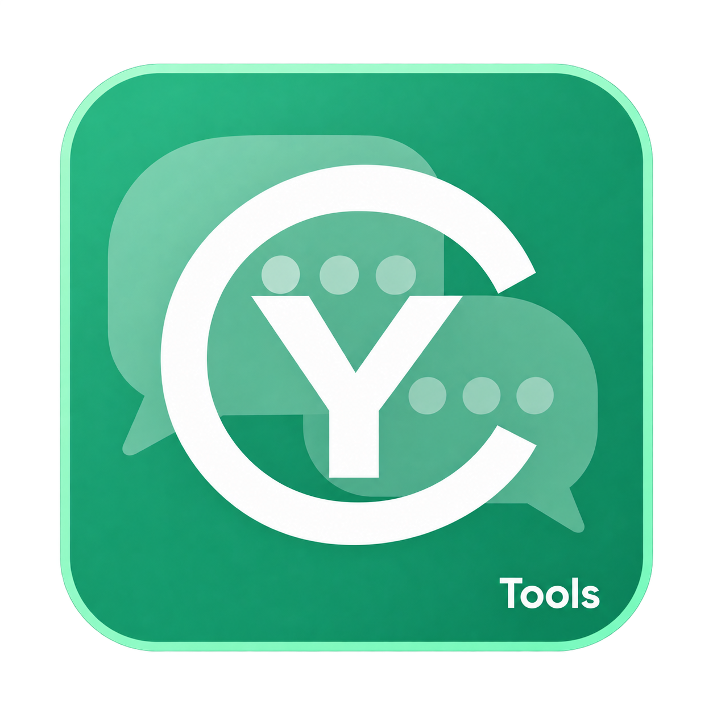
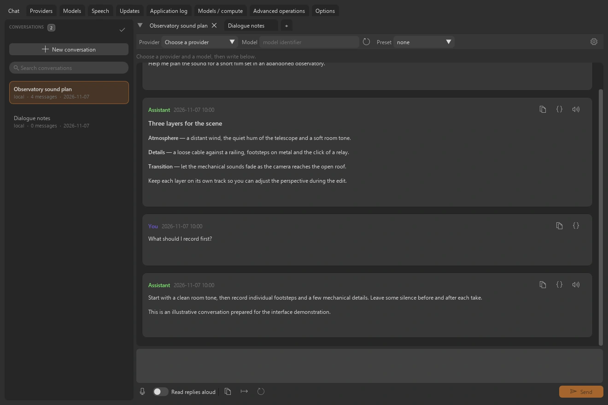
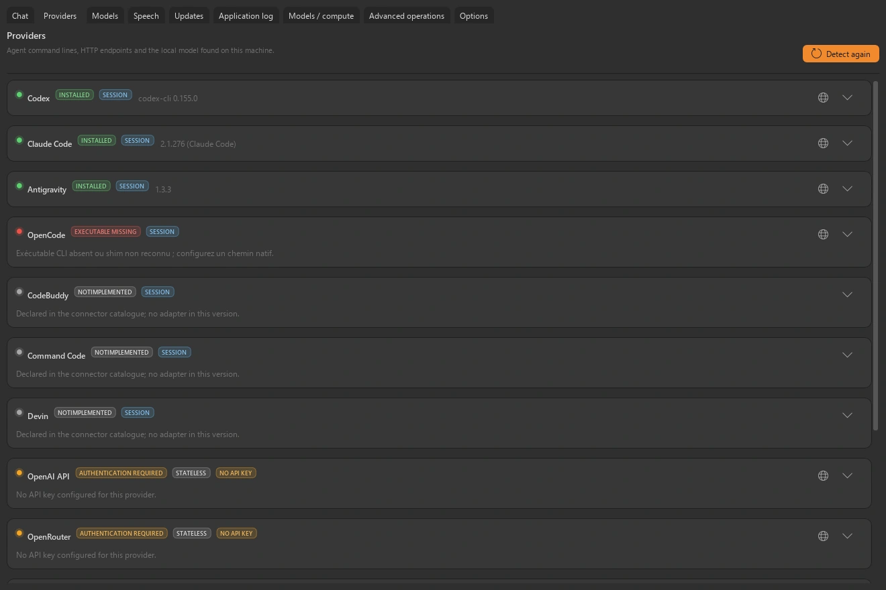
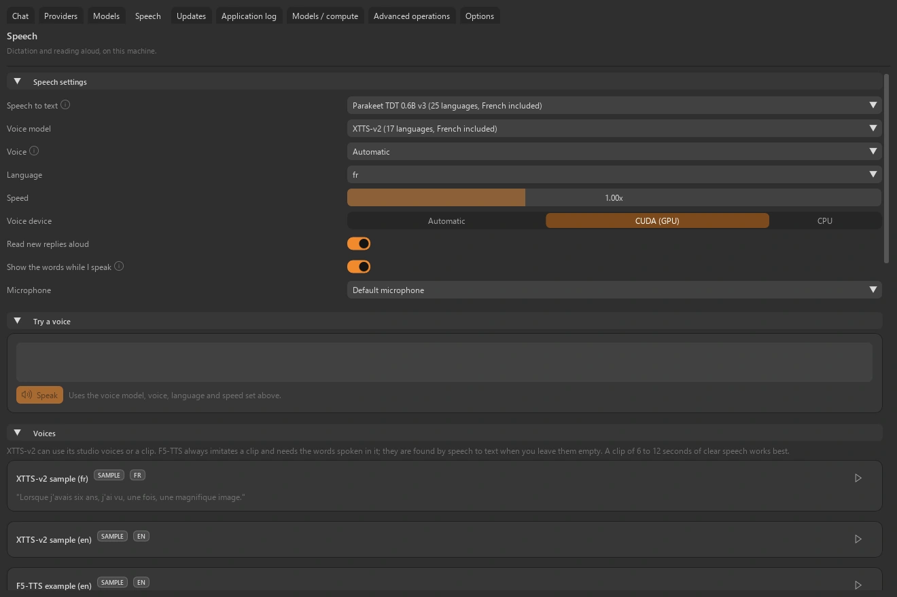

<table width="100%">
  <tr>
    <td width="300" align="left" valign="top">
      <a href="https://mrmybal.github.io/CyTools_AIChat/?lang=fr">Site web</a><br>
      <a href="https://mrmybal.github.io/CyTools_AIChat/Documentation.html#/fr/overview">Documentation</a><br>
      <a href="https://github.com/MrMybal/CyTools_AIChat">GitHub</a><br><br>
      <sub>README</sub><br>
      <a href="README.md">English</a> · <a href="README.fr.md">Français</a>
    </td>
    <td width="400" align="center" valign="middle">
      <a href="https://mrmybal.github.io/CyTools_AIChat/?lang=fr"></a>
    </td>
    <td width="300" align="right" valign="top">
      <p><sub>Licence de l’application</sub><br><a href="LICENSE"><strong>GPL-3.0-only</strong></a></p>
      <p><sub>Version de l’application</sub><br><a href="VERSION.fr.md"><strong>0.2.2</strong></a><br><strong>EXPÉRIMENTAL</strong></p>
      <p><a href="https://github.com/MrMybal/CyTools_AIChat/releases/download/v0.2.2/CyTools_AIChat-0.2.2-windows-x64.zip"><strong>Télécharger</strong></a><br><sub>Windows x64 · portable</sub></p>
    </td>
  </tr>
</table>

<h1 align="center">CyTools AIChat</h1>

Maintenance : **Cyberalien**.


Retrouvez vos conversations, passez des assistants connectés aux modèles locaux et ajoutez la voix lorsque vous en avez besoin. Pour écrire, explorer des idées et réunir différents modèles de langage dans une application de bureau.

> **EXPÉRIMENTAL · 0.2.2**
>
> Version Windows publiée pour évaluation ; certains parcours des moteurs restent à valider. Consultez les [notes de version et limites connues](VERSION.fr.md).

[](website/assets/showcase/conversation.webp)

*Espace de discussion · conversation fictive préparée sans requête à un modèle.*


## L’application

### Conversations

Ouvrez plusieurs onglets, reprenez un échange et conservez son historique sur disque. Fermer un onglet laisse la conversation disponible.

### Connexions

Détectez les lignes de commande compatibles ou configurez un fournisseur HTTP. Les fournisseurs à sessions gardent leur historique natif ; les autres reçoivent la conversation enregistrée. L’interface indique le fournisseur et le modèle.

[](website/assets/showcase/providers.webp)

*Espace fournisseurs · détection et réglages de connexion.*


### Voix

La dictée remplit le message sans l’envoyer. Des moteurs vocaux locaux facultatifs lisent les réponses ; un espace dédié gère les voix et leurs références.

[](website/assets/showcase/speech.webp)

*Réglages vocaux · moteurs et poids sont téléchargés séparément.*


## Fonctionnalités

- **Modèles locaux :** poids GGUF compatibles, choix CPU/CUDA, modèles résidents, intensité des LoRA GGUF et réglages de raisonnement adaptés au modèle.
- **Historique des fournisseurs :** les connecteurs à sessions reprennent la conversation native ; les API sans état utilisent la transcription enregistrée.
- **Gestion des conversations :** recherche, onglets, annulation, presets et export Markdown/JSON. Fermer un onglet ne supprime pas sa conversation.
- **Voix :** dictée locale et lecture des réponses facultatives ; la dictée remplit la saisie sans envoyer le message. Les modèles vocaux et textuels sont installés séparément.
- **Automatisation :** application, CLI et MCP partagent conversations et contrats d’opérations. Les fournisseurs CLI d’agents de cette application sont en lecture seule.

**Application et automatisation :** l’anglais est la langue par défaut ; le français se choisit dans Options. Enregistrez/chargez les configurations, consultez les journaux copiables et utilisez les opérations déclarées par CLI ou MCP. Le [manuel](https://mrmybal.github.io/CyTools_AIChat/Documentation.html#/fr/overview) décrit les paramètres et contrats de sortie réels.

---

## Installation

La version applicative publiée est pour **Windows x64**. Le ZIP portable inclut son Python privé et les dépendances de base de l’interface et des médias. Les modèles et moteurs lourds facultatifs se téléchargent séparément.

1. [Téléchargez CyTools AIChat 0.2.2](https://github.com/MrMybal/CyTools_AIChat/releases/download/v0.2.2/CyTools_AIChat-0.2.2-windows-x64.zip).
2. Extrayez le ZIP complet dans un dossier accessible en écriture. Gardez `app/` et `runtime/` à côté du lanceur.
3. Lancez **CyTools_AIChat.exe**. Utilisez l’espace d’installation/modèles pour les composants nécessaires ; consultez leurs licences et conditions d’accès avant le téléchargement.

Aucun Python système n’est nécessaire pour ouvrir le portable. L’installation depuis les sources et certains moteurs facultatifs nécessitent des outils supplémentaires comme Git. Conservez le dossier complet ; l’exécutable seul ou le ZIP de mise à jour `app` ne constitue pas une installation complète.

Windows x64 est la plateforme testée. Les modèles GGUF locaux utilisent le moteur llama.cpp compatible, sur CPU ou CUDA. Les fournisseurs distants nécessitent leur propre client installé et authentifié ou leur compte. OpenCode et les API payantes n’ont pas tous été exécutés. Un lanceur Linux existe, sans validation.

### Mises à jour et données

Pour une installation compatible existante, utilisez Mises à jour et le paquet applicatif correspondant. Préservez `data/`, les moteurs et les modèles. Ne forcez pas une mise à jour destinée à un autre ABI. Si le runtime requis change, installez le portable complet dans un dossier séparé et suivez la migration.

## Sources, compilation et bibliothèques nécessaires

<details>
<summary>Installation des sources Windows et outils de compilation facultatifs</summary>


Utilisez Python **3.11** pour l’environnement de base depuis les sources. Git sert au clonage et aux dépendances Git épinglées. Compiler le lanceur nécessite les Build Tools MSVC x64 et une invite développeur.

```powershell
git clone https://github.com/MrMybal/CyTools_AIChat.git
cd CyTools_AIChat
py -3.11 -m venv runtime\python
runtime\python\Scripts\python.exe -m pip install -r app\requirements.txt
powershell -File app\build_launcher.ps1
.\CyTools_AIChat.exe
```

Les dépendances de base exactes sont dans [app/requirements.txt](app/requirements.txt). Les moteurs utilisent leurs propres environnements et catalogues ; installer la base ne les installe pas. Consultez le [guide développeur](app/README.md) pour la compilation détaillée et les composants facultatifs.

</details>

---

## Licence

**CyTools AIChat utilise la licence [GPL-3.0-only](LICENSE).** CyToolsCore, CyUI et CyDoc restent des composants MIT ; leurs licences ne changent pas celle de l’application. Moteurs, plugins et poids conservent leurs propres conditions.

### Principaux composants et bibliothèques tierces

| Bibliothèque · sources | Licence · texte | Utilisation / périmètre |
| --- | --- | --- |
| [CyToolsCore 0.10.1](https://github.com/MrMybal/CyToolsCore) | [MIT](LICENCES/CyToolsCore-MIT.txt) | SDK/runtime : jobs, sessions, ressources, CLI et MCP. |
| [CyUI 1.2.0](https://github.com/MrMybal/CyUI) | [MIT](LICENCES/CyUI-MIT.txt) | Modules Python d’interface sélectionnés et inclus. |
| [CyDoc 0.1.0](https://github.com/MrMybal/CyDoc) | [MIT](LICENCES/CyDoc-MIT.txt) | Lecteur local inclus ; Node/npm servent uniquement à la rédaction/génération. |
| [Dear ImGui / imgui-bundle](https://github.com/pthom/imgui_bundle) | [MIT + notices des composants](https://github.com/pthom/imgui_bundle/blob/main/LICENSE) | Rendu de l’interface et composants natifs inclus. |
| [CPython 3.11](https://www.python.org/) | [PSF + notices des composants](https://docs.python.org/3.11/license.html) | Runtime privé inclus dans l’archive Windows portable. |
| [NumPy / Pillow](https://numpy.org/) | [BSD-3-Clause / MIT-CMU](LICENCES/SOURCES.txt) | Runtime de base : tableaux et images. |
| [sounddevice / PortAudio](https://github.com/spatialaudio/python-sounddevice) | [MIT / PortAudio terms](LICENCES/SOURCES.txt) | Lecture et capture du microphone. |
| [llama.cpp](https://github.com/ggml-org/llama.cpp) | [MIT](https://github.com/ggml-org/llama.cpp/blob/master/LICENSE) | Moteur CPU/CUDA facultatif ; les bibliothèques CUDA conservent les conditions NVIDIA. |
| [Speech engine packages](app/requirements-speech-tts.txt) | [BSD-3-Clause / Apache-2.0 / MPL-2.0 / MIT](LICENCES/SOURCES.txt) | Environnements facultatifs PyTorch, transformers, coqui-tts et F5-TTS ; licences des modèles distinctes. |
| [cyai_connectors](app/aichat/vendor/cyai_connectors) | [Aucune licence autonome déclarée](LICENCES/SOURCES.txt) | Sources des connecteurs incluses ; conserver les notices de distribution du projet. |

Ce tableau indexe les principaux composants sans remplacer leurs notices transitives complètes. Conservez [LICENCES/](LICENCES/), [app/licenses.json](app/licenses.json), les licences des paquets installés et celles de chaque moteur/modèle facultatif. Les bibliothèques CUDA installées conservent aussi les conditions NVIDIA.

## Références et liens

- [Documentation](https://mrmybal.github.io/CyTools_AIChat/Documentation.html#/fr/overview)
- [Site web](https://mrmybal.github.io/CyTools_AIChat/?lang=fr)
- [Dépôt des sources](https://github.com/MrMybal/CyTools_AIChat) · [Releases et sommes de contrôle](https://github.com/MrMybal/CyTools_AIChat/releases)
- [Suivi des problèmes](https://github.com/MrMybal/CyTools_AIChat/issues) · [Notes de version](VERSION.fr.md)
- [Guide développeur](app/README.md)

<details>
<summary><strong>AI Usage</strong></summary>

- [Commencer ici : guide IA du projet](app/AGENTS.md) — règles du produit et fichiers importants.
- [Opérations et intégration IA](app/Documentation/DocAI.md) — contrats réels et utilisation en tâches.
- [Compiler cette application](app/README.md) — installation des sources et commandes propres au produit.

</details>
