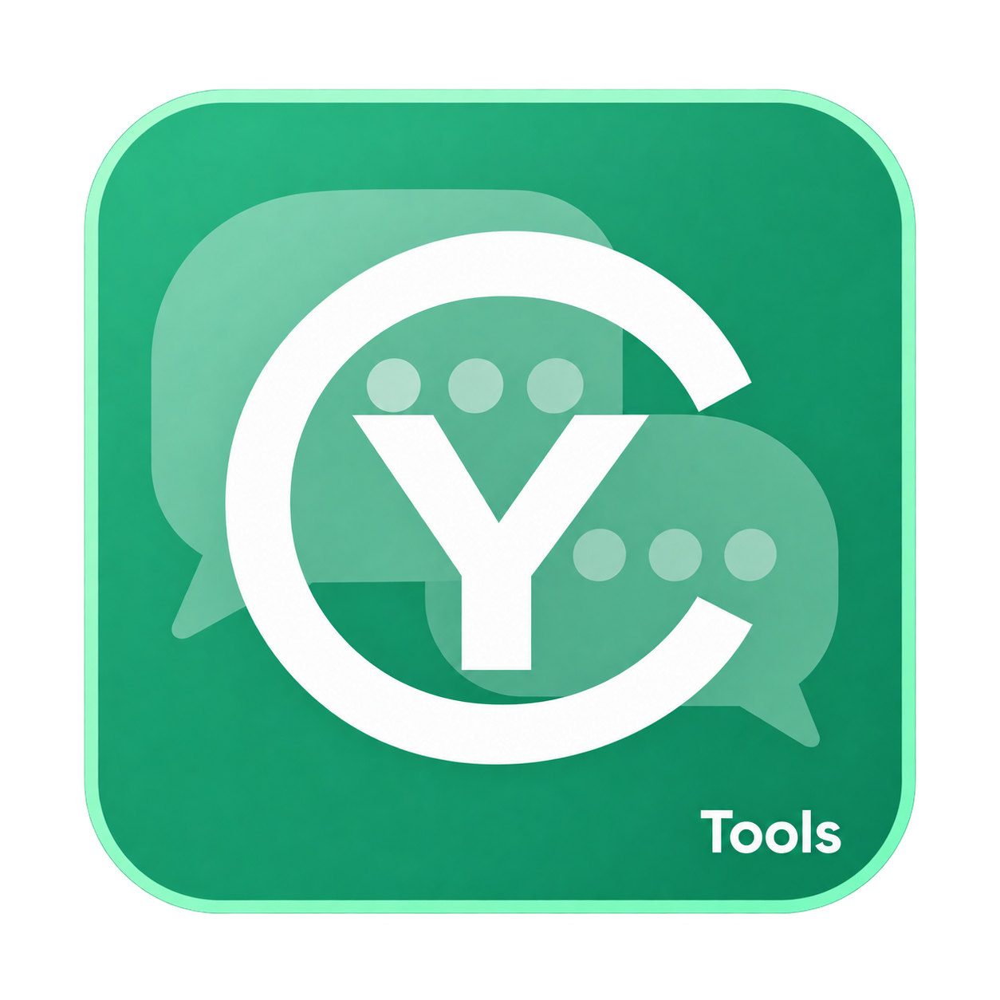
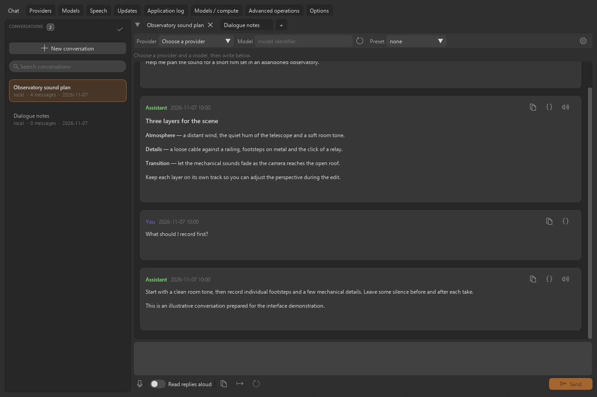
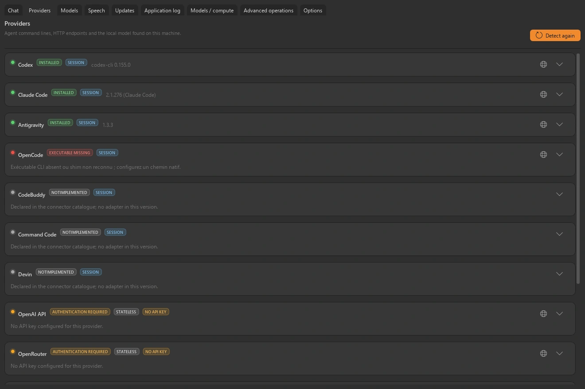
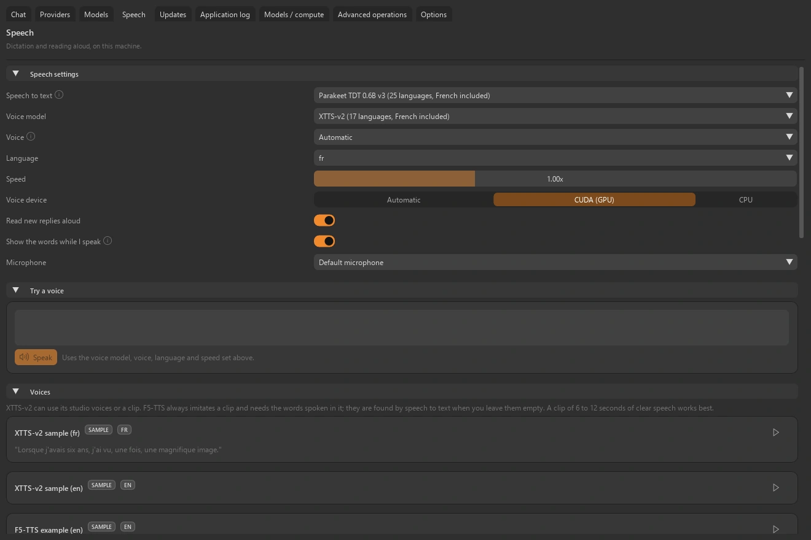

<table width="100%">
  <tr>
    <td width="300" align="left" valign="top">
      <a href="https://mrmybal.github.io/CyTools_AIChat/">Website</a><br>
      <a href="https://mrmybal.github.io/CyTools_AIChat/Documentation.html#/en/overview">Documentation</a><br>
      <a href="https://github.com/MrMybal/CyTools_AIChat">GitHub</a><br><br>
      <sub>README</sub><br>
      <a href="README.md">English</a> · <a href="README.fr.md">Français</a>
    </td>
    <td width="400" align="center" valign="middle">
      <a href="https://mrmybal.github.io/CyTools_AIChat/"></a>
    </td>
    <td width="300" align="right" valign="top">
      <p><sub>Application license</sub><br><a href="LICENSE"><strong>GPL-3.0-only</strong></a></p>
      <p><sub>Application version</sub><br><a href="VERSION.md"><strong>0.2.2</strong></a><br><strong>EXPERIMENTAL</strong></p>
      <p><a href="https://github.com/MrMybal/CyTools_AIChat/releases/download/v0.2.2/CyTools_AIChat-0.2.2-windows-x64.zip"><strong>Download</strong></a><br><sub>Windows x64 · portable</sub></p>
    </td>
  </tr>
</table>

<h1 align="center">CyTools AIChat</h1>

Maintained by **Cyberalien**.


Keep your conversations together, switch between connected assistants and local models, and add a voice when you need one. For people who write, explore ideas and want one desktop home for different language models.

> **EXPERIMENTAL · 0.2.2**
>
> Published Windows build for evaluation; some engine paths remain unvalidated. Read the [version notes and known limitations](VERSION.md).

[](website/assets/showcase/conversation.webp)

*Chat workspace · illustrative conversation, prepared without sending a model request.*


## The application

### Conversations

Open several tabs, return to an earlier thread and keep the transcript on disk. Closing a tab keeps the conversation available.

### Connections

Detect supported agent command lines or configure an HTTP provider. Session providers keep their native history; stateless providers receive the saved transcript. The interface identifies the provider and model.

[](website/assets/showcase/providers.webp)

*Providers workspace · detection and connection settings.*


### Speech

Dictation writes into the message box without sending it. Optional local speech engines read replies aloud; voice settings and reference takes are managed in a dedicated workspace.

[](website/assets/showcase/speech.webp)

*Speech settings · engines and weights are separate downloads.*


## Features

- **Local models:** compatible GGUF weights, CPU/CUDA engine selection, resident models, GGUF LoRA strength and model-specific reasoning settings.
- **Provider history:** session-based agent connectors resume their native conversation; stateless APIs use the saved transcript.
- **Conversation management:** searchable saved threads, tabs, cancellation, presets and Markdown/JSON export. Closing a tab does not delete its conversation.
- **Voice:** optional local dictation and spoken replies; dictation fills the input without sending a message. Speech and text models are installed separately.
- **Automation:** the desktop, CLI and MCP share stored conversations and operation contracts. Agent CLI providers in this application are read-only.

**Desktop and automation:** English is the default interface language; French is selectable in Options. Save/load generation configurations, follow copyable application logs and use the declared operations through the CLI or MCP. The [manual](https://mrmybal.github.io/CyTools_AIChat/Documentation.html#/en/overview) describes the real parameters and output contracts.

---

## Installation

The published application build is **Windows x64**. The portable ZIP includes its private Python runtime and base UI/media dependencies. Models and optional heavy engines are separate downloads.

1. [Download CyTools AIChat 0.2.2](https://github.com/MrMybal/CyTools_AIChat/releases/download/v0.2.2/CyTools_AIChat-0.2.2-windows-x64.zip).
2. Extract the complete ZIP into a writable folder. Keep `app/` and `runtime/` beside the launcher.
3. Open **CyTools_AIChat.exe**. Use the installation/model workspace for the components you need; review each component licence and any provider access conditions before download.

No machine Python is needed just to open the portable application. Source setup and some optional engine installers require additional tools such as Git. Keep the full release folder; the standalone `.exe` or an `app` update ZIP alone is not a complete installation.

Windows x64 is the tested platform. Local GGUF models use the compatible llama.cpp CPU or CUDA engine. Remote providers need their own installed/authenticated client or account. OpenCode and paid provider APIs were not all exercised. Linux has a launcher but is unvalidated.

### Updates and data

For an existing compatible installation, use its Updates page and the matching application update package. Keep `data/`, installed engines and models. An update for another runtime ABI must not be forced. If the required runtime changes, use the complete portable release in a separate folder and follow the migration instructions.

## Source, build and required libraries

<details>
<summary>Windows source setup and optional build tools</summary>


Use Python **3.11** for the base source environment. Git is needed for cloning and pinned Git requirements. Building the launcher needs the MSVC x64 Build Tools; use a developer command prompt.

```powershell
git clone https://github.com/MrMybal/CyTools_AIChat.git
cd CyTools_AIChat
py -3.11 -m venv runtime\python
runtime\python\Scripts\python.exe -m pip install -r app\requirements.txt
powershell -File app\build_launcher.ps1
.\CyTools_AIChat.exe
```

The exact base requirements are in [app/requirements.txt](app/requirements.txt). Engines use their own environments and model catalogues; installing the base environment does not install them. Follow the [developer setup](app/README.md) for the detailed build and optional components.

</details>

---

## License

**CyTools AIChat is licensed under [GPL-3.0-only](LICENSE).** CyToolsCore, CyUI and CyDoc remain MIT components; their licences do not change the application licence. Optional engines, plugins and model weights retain their own terms.

### Main components and third-party libraries

| Library · source | License · terms | Use / scope |
| --- | --- | --- |
| [CyToolsCore 0.10.1](https://github.com/MrMybal/CyToolsCore) | [MIT](LICENCES/CyToolsCore-MIT.txt) | SDK/runtime: jobs, sessions, resources, CLI and MCP. |
| [CyUI 1.2.0](https://github.com/MrMybal/CyUI) | [MIT](LICENCES/CyUI-MIT.txt) | Selected bundled Python UI modules. |
| [CyDoc 0.1.0](https://github.com/MrMybal/CyDoc) | [MIT](LICENCES/CyDoc-MIT.txt) | Bundled offline reader; Node/npm are authoring/build tools only. |
| [Dear ImGui / imgui-bundle](https://github.com/pthom/imgui_bundle) | [MIT + component notices](https://github.com/pthom/imgui_bundle/blob/main/LICENSE) | Desktop renderer and its bundled native components. |
| [CPython 3.11](https://www.python.org/) | [PSF + component notices](https://docs.python.org/3.11/license.html) | Private runtime included in the Windows portable archive. |
| [NumPy / Pillow](https://numpy.org/) | [BSD-3-Clause / MIT-CMU](LICENCES/SOURCES.txt) | Base runtime: arrays and images. |
| [sounddevice / PortAudio](https://github.com/spatialaudio/python-sounddevice) | [MIT / PortAudio terms](LICENCES/SOURCES.txt) | Playback and microphone capture. |
| [llama.cpp](https://github.com/ggml-org/llama.cpp) | [MIT](https://github.com/ggml-org/llama.cpp/blob/master/LICENSE) | Optional CPU/CUDA model engine; CUDA libraries retain NVIDIA terms. |
| [Speech engine packages](app/requirements-speech-tts.txt) | [BSD-3-Clause / Apache-2.0 / MPL-2.0 / MIT](LICENCES/SOURCES.txt) | Optional PyTorch, transformers, coqui-tts and F5-TTS environments; model licences are separate. |
| [cyai_connectors](app/aichat/vendor/cyai_connectors) | [No standalone license declared](LICENCES/SOURCES.txt) | Included connector sources; retain the project distribution notices. |

This table indexes the main components; it does not replace their complete transitive notices. Retain [LICENCES/](LICENCES/), [app/licenses.json](app/licenses.json), the licences beside installed packages and the notices in each optional engine/model. CUDA libraries, when installed, also retain NVIDIA’s terms.

## References and links

- [Documentation](https://mrmybal.github.io/CyTools_AIChat/Documentation.html#/en/overview)
- [Website](https://mrmybal.github.io/CyTools_AIChat/)
- [Source repository](https://github.com/MrMybal/CyTools_AIChat) · [Releases and checksums](https://github.com/MrMybal/CyTools_AIChat/releases)
- [Issue tracker](https://github.com/MrMybal/CyTools_AIChat/issues) · [Version notes](VERSION.md)
- [Developer setup](app/README.md)

<details>
<summary><strong>AI Usage</strong></summary>

- [Start here: project agent guide](app/AGENTS.md) — product rules and important files.
- [Operations and AI integration](app/Documentation/DocAI.md) — actual tool contracts and task usage.
- [Build this application](app/README.md) — source setup and application-specific commands.

</details>
